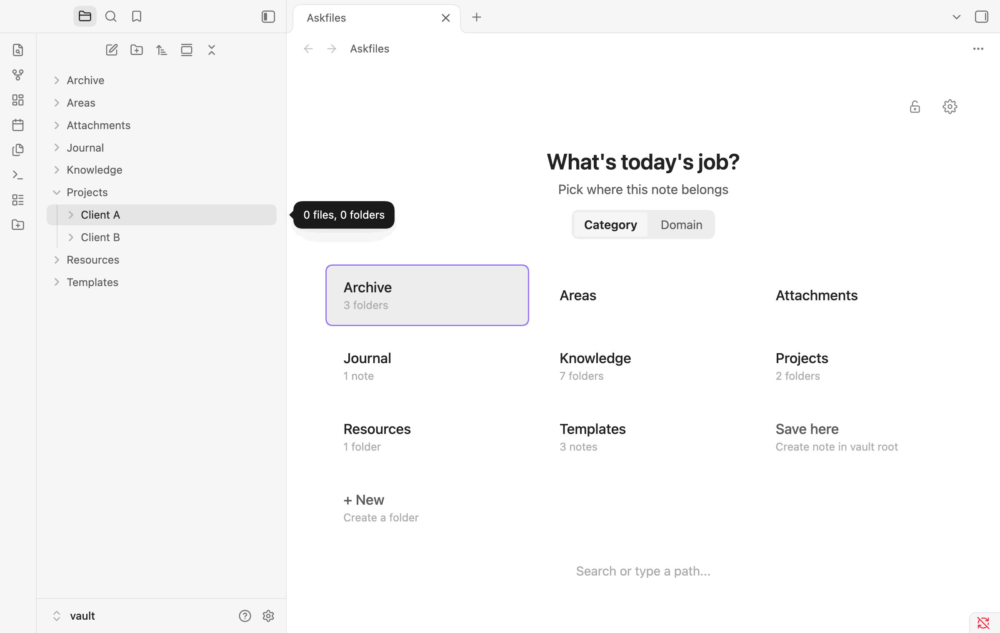
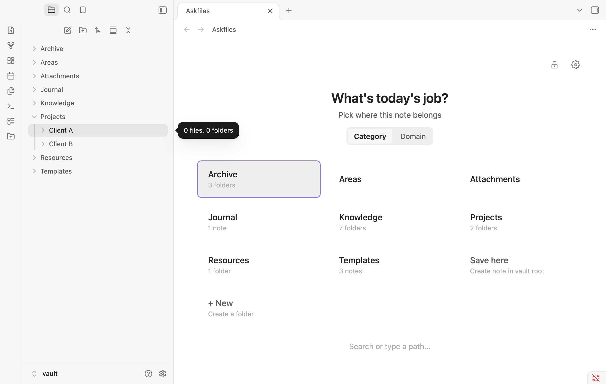
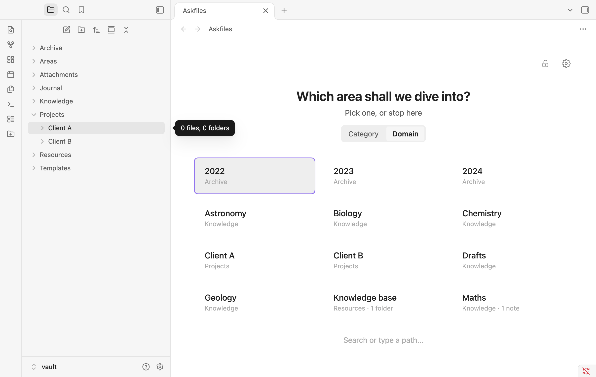
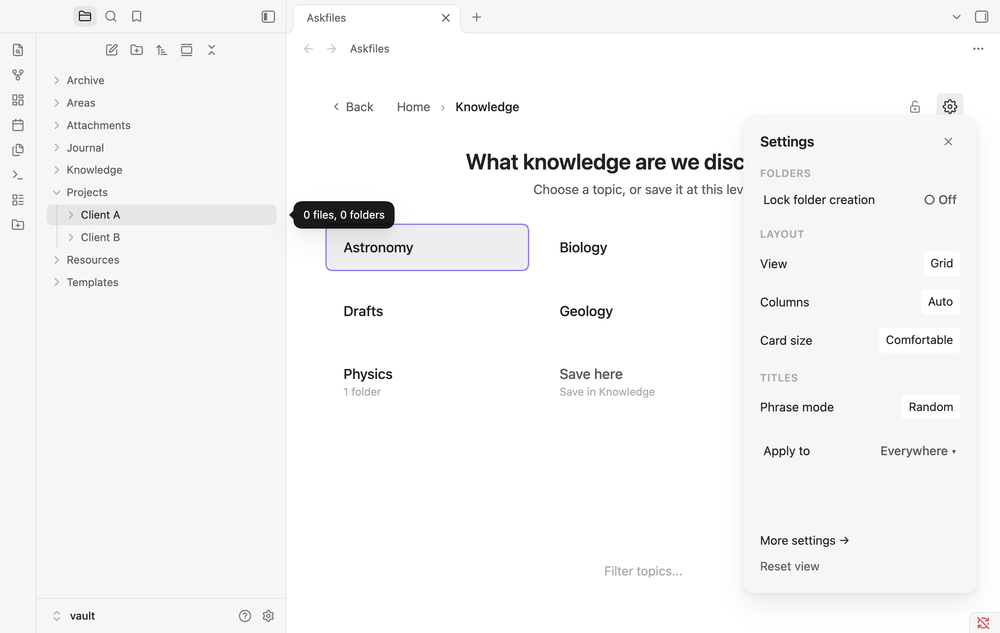
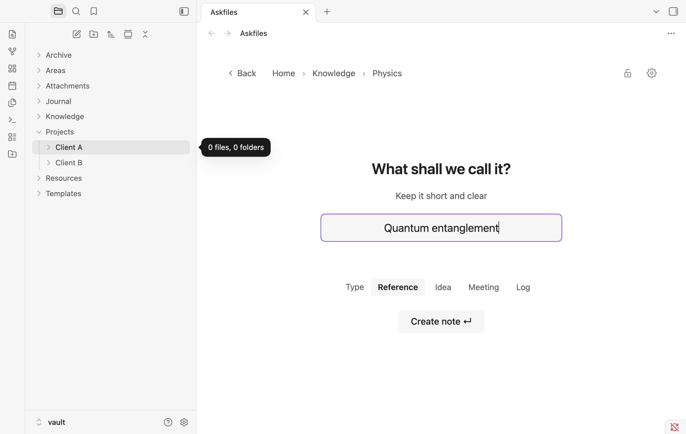
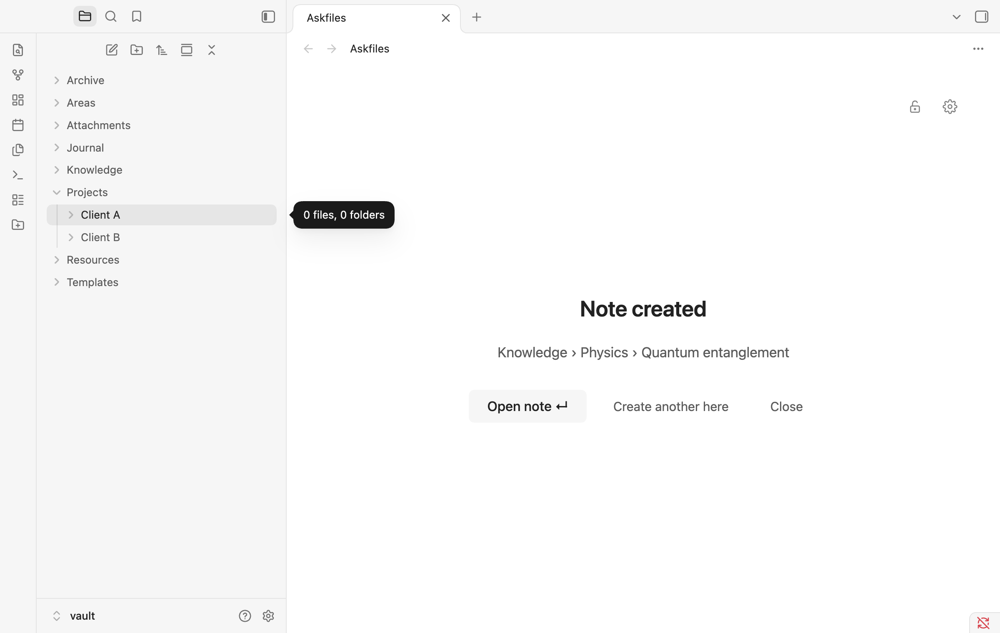
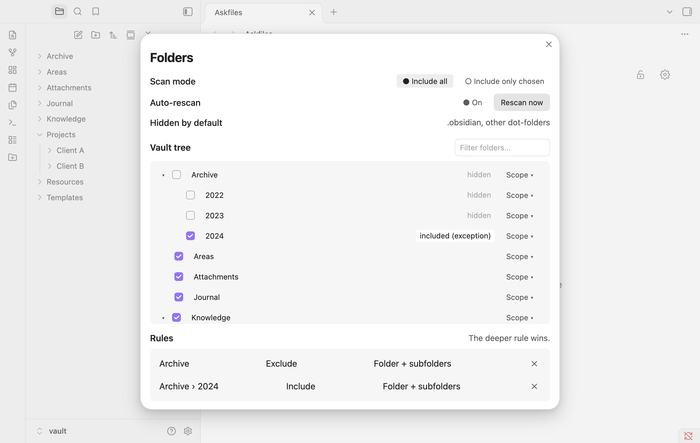

# Askfiles for Obsidian

**Askfiles** (*"ask, then file"*) is a calm, question-by-question note creator for Obsidian where **your vault's folders are the choices**.

Instead of staring at a blank `Untitled` tab or digging through a nested folder tree in the sidebar, Askfiles turns note creation into a brief, guided conversation. Pick a folder card, drill down as far as you want (or stop early with **Save here**), name your note, and start writing—with your frontmatter properties and template already filled in.



---

## Why Askfiles?

Most vaults already have a natural structure—top-level categories like `Knowledge`, `Projects`, `Journal`, and `Study`, with domains like `Physics`, `Software`, or `Web App` inside them.

When you press `Cmd/Ctrl + N`, Obsidian either drops a note at the vault root or inside whatever folder you happened to click last. Filing it properly takes extra mental overhead.

**Askfiles flips the flow:**
1. **Zero setup required** — It reads your existing vault folders immediately. No database to configure, no tags to maintain.
2. **Start by Category or by Domain** — Toggle between **Category** (top-level folders) and **Domain** (second-level folders across your whole vault) right on the Home page.
3. **Stop at any depth** — Every subfolder level gives you a **Save here** option if you don't want to drill any deeper, or automatically advances to the naming screen when you reach a leaf folder.
4. **Borderless, quiet design** — No heavy boxes or visual clutter. Cards rest gently on your theme's canvas and highlight with a soft surface tint on hover or keyboard focus.

---

## Walkthrough

### 1. Start by Category or jump straight to a Domain

On the Home page, use the **`Category | Domain`** pill right above the question to choose how you think:

- **Category** asks a top-level question (*"What's today's job?"*) and presents your root folders (`Journal`, `Knowledge`, `Projects`, `Study`).
- **Domain** swaps to a deeper question (*"Which area shall we dive into?"*) and shows all your second-level domain folders (`Physics`, `Software`, `Web App`, `Calculus`) with their parent category shown underneath. If a domain name exists in only one category, clicking it jumps straight to `<Category>/<Domain>`.

| Start by Category | Start by Domain |
| :---: | :---: |
|  |  |

---

### 2. Drill down & customize the view on the fly

As you pick a folder, a clickable breadcrumb trail builds at the top so you can jump back to any earlier step with a single click.

Click the **Gear icon (`⚙`)** in the top-right corner to slide out the **Live-Preview Gear Panel** without leaving your tab:
- Switch between **Grid** and **List** views
- Adjust **Columns** (`Auto`, `2`, `3`, `4`), **Card size**, **Descriptions**, and **Sort order**
- Change how the question phrase is chosen (**Fixed**, **Random**, or **Rotate**) and cycle to the next phrase immediately
- Apply layout tweaks to **This folder only** or **Everywhere**



---

### 3. Name your note & pick a Note Type

Once you reach a folder with no subfolders (or click **Save here**), Askfiles asks *"What shall we call it?"*:
- Checks for duplicate note names in real time
- Lets you optionally pick a **Note type** (`Standard`, `Fleeting`, `Literature`, `Project`, `Meeting`, `Reference`)
- Automatically writes your path choices into YAML frontmatter (`category`, `domain`, `subdomain`, `type`) and applies any template configured for that note type

| Naming & Note Types | Note Created Confirmation |
| :---: | :---: |
|  |  |

---

### 4. Fine-grained Folder Rules (Include / Exclude Tree)

Have an `Archive`, `Templates`, or `Attachments` folder you never want to see as a choice? Or want to hide `Archive` *except* for `Archive/2024`?

Open **Settings → Askfiles → Folders → Open folder tree** to toggle folders visually with three scopes:
- **This folder and everything inside**
- **Only the subfolders**
- **Only this folder**

The **deeper rule always wins**, so you can exclude an entire branch and re-include a specific subfolder inside it—and rules automatically update when you rename or move folders in Obsidian.



---

## Keyboard-First Navigation

You can complete the entire flow without touching the mouse:

| Key | Action |
| :--- | :--- |
| `1` – `9` | Pick the matching folder card (`1` selects **Save here** when present) |
| `Arrow keys` | Move focus between folder cards |
| `Enter` | Select the focused card or create the note |
| `/` or `Cmd/Ctrl + F` | Focus the bottom quick-jump search bar |
| `Backspace` / `Alt + ←` | Go back one folder level |
| `Escape` | Clear search, close the Gear panel, or step back |

---

## Commands

Open the Obsidian Command Palette (`Cmd/Ctrl + P`) and run:
- **Askfiles: Open Askfiles** — Open the Askfiles tab (also accessible from the left ribbon icon or optionally on startup / new tab).
- **Askfiles: Create note here (from current folder)** — Start the Askfiles flow pre-positioned inside the folder of your currently active note.
- **Askfiles: Lock / unlock folder creation** — Toggle the folder lock (`🔒`) so no new folders can be created accidentally from the search bar or `+ New folder` card.

---

## Installation

### From GitHub Releases
1. Download `main.js`, `manifest.json`, and `styles.css` from the [latest release](https://github.com/jrayas/askfiles/releases/latest).
2. In your Obsidian vault, create the folder `.obsidian/plugins/askfiles/`.
3. Copy `main.js`, `manifest.json`, and `styles.css` into that folder.
4. Reload Obsidian and enable **Askfiles** under **Settings → Community plugins**.

### Build from Source
```bash
git clone https://github.com/jrayas/askfiles.git
cd askfiles
npm install
npm run build
```

---

## Privacy & Offline Guarantee

Askfiles runs **100% locally inside your vault**. It makes zero network requests, requires no account or telemetry, and stores all settings inside your vault's plugin configuration.

---

## License

MIT © [Anthirayas](https://github.com/jrayas)
