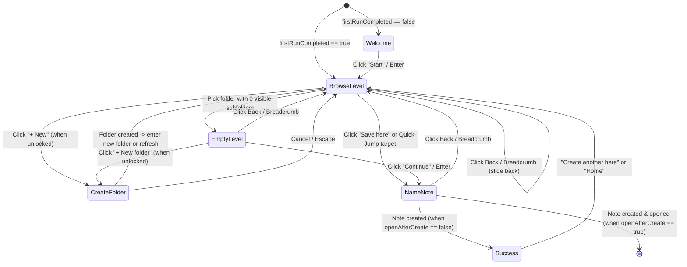

# Askfiles — System Architecture

## 1. High-Level Architecture

Askfiles is structured as a modular TypeScript codebase compiled into a single `main.js` bundle via `esbuild`, paired with `manifest.json` and `styles.css`. It has **zero runtime npm dependencies** (`obsidian` provides the runtime API, fuzzy search, frontmatter processing, and workspace management).

```mermaid
flowchart TD
    subgraph Obsidian["Obsidian Runtime (1.14.x)"]
        Vault["app.vault"]
        FileManager["app.fileManager"]
        Workspace["app.workspace"]
        Metadata["app.metadataCache"]
    end

    subgraph Core["Askfiles Core Engines"]
        Plugin["AskfilesPlugin (main.ts)"]
        Store["SettingsStore (settings/store.ts)"]
        FolderEngine["FolderEngine (engine/folder-engine.ts)"]
        PhraseEngine["PhraseEngine (engine/phrase-engine.ts)"]
        NoteCreator["NoteCreator (engine/note-creator.ts)"]
    end

    subgraph UI["Askfiles User Interface"]
        MainView["AskfilesView (views/askfiles-view.ts)"]
        GearDrawer["GearPanel (ui/gear-panel.ts)"]
        Icons["LineIconSet (ui/icons.ts)"]
        SettingTab["AskfilesSettingTab (settings/setting-tab.ts)"]
        ManageModals["Manage Screens & Modals (settings/modals/*)"]
    end

    Plugin --> Store
    Plugin --> FolderEngine
    Plugin --> PhraseEngine
    Plugin --> NoteCreator
    Plugin --> MainView
    Plugin --> SettingTab

    Vault <--> FolderEngine
    Vault <--> NoteCreator
    FileManager <--> NoteCreator

    MainView --> FolderEngine
    MainView --> PhraseEngine
    MainView --> NoteCreator
    MainView --> GearDrawer
    MainView --> Icons
    MainView <--> Store

    SettingTab <--> Store
    SettingTab --> FolderEngine
    SettingTab --> PhraseEngine
    SettingTab --> ManageModals
```



---

## 2. Source Directory Structure

```text
askfiles-brief/
├── manifest.json                         # Obsidian plugin manifest (id: "askfiles", minAppVersion: "1.13.4")
├── package.json                          # Build, lint, and CDP debug scripts
├── tsconfig.json                         # TypeScript 5.9 strict config (ES2021 target)
├── esbuild.config.mjs                    # esbuild bundler (CJS, ES2021, external: obsidian)
├── eslint.config.mts                     # eslint-plugin-obsidianmd 0.4.2 recommended config
├── .stylelintrc.json                     # stylelint + no-unsupported-browser-features (chrome 138)
├── styles.css                            # All plugin styles (borderless layout, variables, responsive)
├── src/
│   ├── main.ts                           # AskfilesPlugin lifecycle, commands, event registration
│   ├── types.ts                          # All persisted & runtime TypeScript interfaces
│   ├── constants.ts                      # View type IDs, starter phrases, default settings
│   ├── settings/
│   │   ├── store.ts                      # Settings load/save/normalize + change pub/sub listeners
│   │   ├── setting-tab.ts                # Declarative PluginSettingTab (getSettingDefinitions)
│   │   └── modals/
│   │       ├── folder-rules-modal.ts     # Interactive Vault Tree Picker + Rule Scopes & Live Count
│   │       ├── phrase-library-modal.ts   # Phrase Library manager (add/edit/toggle/import/export/restore)
│   │       ├── folder-wording-modal.ts   # Per-folder question wording overrides manager
│   │       ├── templates-modal.ts        # Note types & template mapping manager
│   │       └── shortcuts-modal.ts        # In-view keyboard shortcuts configurator
│   ├── engine/
│   │   ├── folder-engine.ts              # Vault tree scanner, include/exclude evaluator, rename tracker
│   │   ├── phrase-engine.ts              # Phrase selector (fixed/random/rotate, paired/mixed, overrides)
│   │   └── note-creator.ts               # Path validation, sanitization, template + frontmatter writer
│   ├── views/
│   │   └── askfiles-view.ts              # Main ItemView (wizard state machine, transitions, keyboard nav)
│   └── ui/
│       ├── icons.ts                      # Matching SVG line icons (padlock-open, padlock-closed, gear, etc.)
│       ├── gear-panel.ts                 # Slide-in in-tab settings panel & mobile bottom sheet
│       └── apply-to-modal.ts             # "Apply to: This folder only / Everywhere" confirmation modal
└── scripts/
    └── ...                               # Isolated Obsidian + CDP test harness scripts (dev only)
```

---

## 3. Wizard State Machine (`AskfilesView`)

The main tab (`AskfilesView` extending `ItemView`) operates as a deterministic, single-screen-at-a-time state machine:



### Step Screens
1. **`welcome`**: Displayed only when `settings.firstRunCompleted === false`. Shows the total count of discovered vault folders and a primary `Start ↵` button.
2. **`browse`**: Displays the active folder level (starting at `settings.rootFolder`, default `"/"`). Shows visible child folders as cards, plus a `Save here` card and (when unlocked) a `+ New` card. Includes bottom filter input (or quick-jump search input).
3. **`empty`**: Displayed when the user selects a folder that has no visible subfolders. Offers `Continue ↵` (proceed to naming in this folder) and, when unlocked, `+ New folder`.
4. **`new-folder`**: Inline screen to create a subfolder inside the current folder when `lockFolderCreation === false`. If locked while on this screen, shows the friendly lock warning.
5. **`naming`**: Final step where the user enters the note title, sees live validation (duplicate note detection, invalid character replacement suggestion), optionally selects a Note Type pill/dropdown, and presses `Create note ↵`.
6. **`vanished`**: Displayed if the currently active folder was deleted externally outside Askfiles, offering `Go back to Home` or `Rescan`.
7. **`success`**: Displayed after creating a note, showing the breadcrumb path (`Knowledge › Physics › Quantum entanglement`) with `Open note ↵`, `Create another here`, and `Close`.

---

## 4. Reactivity & Synchronization

- **Single Source of Truth for Settings (`SettingsStore`)**:
  - Toggling the lock padlock in the top bar calls `store.update({ lockFolderCreation: !locked })`.
  - `SettingsStore` notifies all subscribed views (`AskfilesView`, open `GearPanel`, and `AskfilesSettingTab`), ensuring the top-bar padlock, the gear panel toggle, and the `+ New` cards update synchronously on the same frame.
- **Live Vault Event Synchronization**:
  - Inside `this.app.workspace.onLayoutReady`, the plugin registers `vault.on('create')`, `vault.on('delete')`, and `vault.on('rename')`.
  - When a `TFolder` is renamed or moved, `FolderEngine.handleFolderRename(folder, oldPath)` automatically migrates any matching paths in:
    - `settings.folderRules`
    - `settings.perFolderLayouts`
    - `settings.perFolderWording`
    - `settings.folderMetadata`
    - Active `AskfilesView` breadcrumb trails (or transitions to the `vanished` state if the current folder was deleted).
